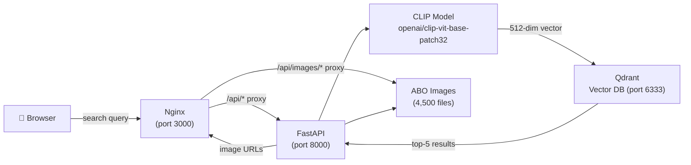

# CLIP Semantic Search — Complete Deployment Guide

> **For:** Your friend deploying this project for the first time
> **Who made it:** A multimodal semantic image-search demo using CLIP, FastAPI, Qdrant, and React

---

## What This Project Is

This is a full-stack **AI-powered visual search engine** over 4,500 Amazon product images.

| Piece | What it does |
|---|---|
| **CLIP** (`openai/clip-vit-base-patch32`) | Encodes text queries into 512-dimensional vectors |
| **FastAPI** (Python) | REST API — takes your text, runs CLIP, queries Qdrant |
| **Qdrant** | Vector database holding 4,500 pre-indexed product image embeddings |
| **React + Nginx** | The UI you search from in the browser |

The app runs as **4 Docker containers**. Everything is wired together with Docker Compose — one command brings it all up.

---

## 🏆 Deployment Options (Completely Free)

> [!IMPORTANT]
> This project has a heavy backend: PyTorch + CLIP model (~1 GB RAM), Qdrant, and 4,500 images. Standard "free tier" options like Render, Railway, and Fly.io are **not enough** (too little RAM). The two realistic free options are below.

### Option A — Oracle Cloud Always Free ✅ BEST OPTION

Oracle gives you a free ARM64 VM with **2 OCPUs + 12 GB RAM** permanently (no credit card charges after the trial). This is enough to run the full Docker Compose stack.

**What you get:** A live public URL like `http://YOUR-IP:3000` — anyone can open it in their browser.

### Option B — Record a Demo Video 🎥 EASIEST

If Option A is too much setup (Oracle can be fiddly), just:
1. Run the project locally (takes ~10 minutes)
2. Record a screen-capture of you using it
3. Upload to LinkedIn / YouTube

This is a completely valid choice for a portfolio post and is what many ML engineers do.

---

## Prerequisites (Install Once)

You need these on whatever computer you're running this on:

| Tool | Why | Install |
|---|---|---|
| **Git** | Clone the repo | Pre-installed on Mac; `sudo apt install git` on Linux |
| **Docker Desktop** | Runs all 4 containers | [docker.com/products/docker-desktop](https://www.docker.com/products/docker-desktop/) |

> [!NOTE]
> Docker Desktop on Mac should be set to at least **8 GB Memory** and **40 GB Disk**. Go to: Docker Desktop → Settings → Resources → drag sliders → Apply & Restart.

Verify everything works:
```bash
git --version
docker --version
docker compose version
```

---

## Part 1 — Run It Locally (Required for Demo Video)

This gets the app running on your own machine. Even for Option A, you should test locally first.

### Step 1 — Clone the Repository

```bash
git clone https://github.com/YOUR-USERNAME/clip-semantic-search.git
cd clip-semantic-search
```

> Replace `YOUR-USERNAME` with the actual GitHub username/URL.

### Step 2 — Download the ABO Image Dataset

The repo includes pre-computed embeddings (the AI math is already done ✅), but the actual image files (~2 GB) must be downloaded from Amazon's public S3 bucket:

```bash
mkdir -p data/ABO
curl --fail --location --retry 3 \
  --output data/ABO/abo-images-small.tar \
  https://amazon-berkeley-objects.s3.us-east-1.amazonaws.com/archives/abo-images-small.tar
```

Extract the archive (this takes a few minutes):
```bash
tar -xf data/ABO/abo-images-small.tar -C data/ABO
```

Verify the images extracted correctly:
```bash
test -d data/ABO/abo-images-small/images/small && echo "✅ Images ready" || echo "❌ Something went wrong"
```

### Step 3 — Start the App

```bash
docker compose up --build -d
```

This builds and starts all 4 containers. **The first run takes 5–15 minutes** because Docker downloads images and builds everything from scratch. After that, restarts are fast.

You'll see it working when:
```bash
docker compose ps
```
Shows:
```
NAME              STATUS
qdrant            running
indexer           exited (0)      ← this is correct, it runs once then exits
api               running
react_frontend    running
```

> [!TIP]
> The indexer exiting with code 0 is **expected and correct** — it loads 4,500 embeddings into Qdrant and quits. If it exits with a non-zero code, check: `docker compose logs indexer`

### Step 4 — Open the App

Open your browser and go to:
```
http://localhost:3000
```

Try searching for:
- `black handbag`
- `comfortable running shoes`
- `cozy bedroom vibe`
- `modern office setup`

Test the API directly:
```bash
curl http://localhost:3000/api/health
# Expected: {"status":"ok"}
```

### Step 5 — Stop the App

```bash
docker compose down
```

---

## Part 2 — Oracle Cloud Free Deployment (Option A)

This makes the app publicly accessible. It stays up 24/7 for free on Oracle's Always Free tier.

> [!WARNING]
> Oracle sometimes shows "Out of host capacity" when creating the VM. If this happens, try a different **Availability Domain** (AD-1, AD-2, AD-3) or try again later (sometimes the next day). This is Oracle's capacity issue, not your fault.

### Step 1 — Create Your Oracle Account

1. Go to [cloud.oracle.com](https://cloud.oracle.com) and sign up
2. You'll need a credit card to verify identity, but the Always Free tier **does not charge you**
3. Choose a home region close to you (e.g., `ap-mumbai-1` for India, `us-ashburn-1` for US)

### Step 2 — Create the Free VM

In the Oracle Cloud dashboard:

1. Go to **Compute → Instances → Create Instance**
2. **Name:** `clip-search-server` (or anything)
3. **Image:** Click "Change Image" → Select **Ubuntu 24.04** (Canonical)
4. **Shape:** Click "Change Shape" → **Ampere → VM.Standard.A1.Flex**
   - Set **OCPUs: 2** and **Memory: 12 GB**
   - *(This is the Always Free allocation)*
5. **Boot Volume:** Set to at least **50 GB**
6. **SSH Keys:** Upload your SSH public key (or generate one — see below)
7. **Networking:** Leave defaults (public subnet, public IP)
8. Click **Create**

**Generate an SSH key (if you don't have one):**
```bash
ssh-keygen -t ed25519 -C "oracle-clip-search"
# Press Enter 3 times for default location and no passphrase
cat ~/.ssh/id_ed25519.pub  # Copy this into Oracle's SSH key box
```

### Step 3 — Open the Firewall Port

In Oracle Cloud, go to your instance's **Virtual Cloud Network (VCN)** → **Security Lists** → Edit the **Ingress Rules**:

Add a new rule:
- **Source CIDR:** `0.0.0.0/0`
- **IP Protocol:** TCP
- **Destination Port Range:** `3000`

Also run this on the VM itself after SSH-ing in (Step 4) to open the OS firewall:
```bash
sudo iptables -I INPUT -p tcp --dport 3000 -j ACCEPT
sudo iptables-save | sudo tee /etc/iptables/rules.v4
```

> [!NOTE]
> Oracle has **two** firewalls: the VCN Security List (in the web UI) AND the OS-level `iptables`. Both must be opened or port 3000 won't be reachable from outside.

### Step 4 — SSH Into the Server

```bash
ssh ubuntu@YOUR-SERVER-PUBLIC-IP
```

Find the public IP in Oracle Console → Compute → Instances → Your instance → "Public IP address"

### Step 5 — Install Docker on the Server

```bash
sudo apt-get update
sudo apt-get install -y ca-certificates curl

sudo install -m 0755 -d /etc/apt/keyrings
sudo curl -fsSL https://download.docker.com/linux/ubuntu/gpg \
  -o /etc/apt/keyrings/docker.asc
sudo chmod a+r /etc/apt/keyrings/docker.asc

echo \
  "deb [arch=$(dpkg --print-architecture) signed-by=/etc/apt/keyrings/docker.asc] https://download.docker.com/linux/ubuntu \
  $(. /etc/os-release && echo "$VERSION_CODENAME") stable" \
  | sudo tee /etc/apt/sources.list.d/docker.list > /dev/null

sudo apt-get update
sudo apt-get install -y docker-ce docker-ce-cli containerd.io docker-buildx-plugin docker-compose-plugin
sudo systemctl enable --now docker
sudo usermod -aG docker "$USER"
newgrp docker
```

Verify:
```bash
docker --version
docker compose version
uname -m   # Should output: aarch64
```

### Step 6 — Clone the Repo and Download Images on the Server

```bash
cd ~
git clone https://github.com/YOUR-USERNAME/clip-semantic-search.git
cd clip-semantic-search

mkdir -p data/ABO
curl --fail --location --retry 3 \
  --output data/ABO/abo-images-small.tar \
  https://amazon-berkeley-objects.s3.us-east-1.amazonaws.com/archives/abo-images-small.tar

tar -xf data/ABO/abo-images-small.tar -C data/ABO
```

### Step 7 — Create the Production Compose File

Create a file called `docker-compose.prod.yml` in the project root:

```bash
nano docker-compose.prod.yml
```

Paste this (replace `YOUR-SERVER-PUBLIC-IP` with your actual Oracle IP):

```yaml
services:
  qdrant:
    image: qdrant/qdrant:latest
    volumes:
      - qdrant_data:/qdrant/storage
    restart: unless-stopped

  indexer:
    build:
      context: .
      dockerfile: Dockerfile.api
    depends_on:
      qdrant:
        condition: service_started
    environment:
      QDRANT_URL: http://qdrant:6333
      QDRANT_COLLECTION_NAME: abo_products_4500
    command: ["uv", "run", "--no-dev", "python", "scripts/index_qdrant.py"]

  api:
    build:
      context: .
      dockerfile: Dockerfile.api
    depends_on:
      indexer:
        condition: service_completed_successfully
    environment:
      QDRANT_URL: http://qdrant:6333
      QDRANT_COLLECTION_NAME: abo_products_4500
      IMAGE_ROOT: /app/images
      API_PUBLIC_URL: http://YOUR-SERVER-PUBLIC-IP:3000/api
    volumes:
      - ./data/ABO/abo-images-small/images/small:/app/images:ro
    restart: unless-stopped

  react_frontend:
    build:
      context: ./frontend-react
      dockerfile: Dockerfile
      args:
        VITE_API_URL: /api
    depends_on:
      - api
    ports:
      - "3000:80"
    restart: unless-stopped

volumes:
  qdrant_data:
```

Save with `Ctrl+O`, then `Ctrl+X`.

### Step 8 — Start the Production Stack

```bash
docker compose -f docker-compose.prod.yml up --build -d
```

The first build on this ARM64 server takes **10–20 minutes** (downloading PyTorch etc.). Subsequent restarts are fast.

Monitor progress:
```bash
docker compose -f docker-compose.prod.yml logs -f api
```

Check all containers are up:
```bash
docker compose -f docker-compose.prod.yml ps
```

### Step 9 — Access Your Live App

Open in any browser:
```
http://YOUR-SERVER-PUBLIC-IP:3000
```

Test health:
```bash
curl http://YOUR-SERVER-PUBLIC-IP:3000/api/health
# Expected: {"status":"ok"}
```

**Share this URL with anyone!** 🎉

---

## Keeping It Running

The containers have `restart: unless-stopped` — they come back automatically if the server reboots.

To update after pushing changes to GitHub:
```bash
cd ~/clip-semantic-search
git pull
docker compose -f docker-compose.prod.yml up --build -d
docker image prune -f
```

To view live logs:
```bash
docker compose -f docker-compose.prod.yml logs -f api
docker compose -f docker-compose.prod.yml logs -f react_frontend
```

To stop everything:
```bash
docker compose -f docker-compose.prod.yml down
```

---

## Troubleshooting

### "Connection refused" on port 3000
- **Oracle VCN Security List:** Did you add TCP port 3000 inbound? (web UI)
- **OS iptables:** Did you run the iptables command on the server?
- Check containers are running: `docker compose -f docker-compose.prod.yml ps`

### Indexer exited with non-zero code
```bash
docker compose -f docker-compose.prod.yml logs indexer
```
Usually means Qdrant wasn't ready. Try restarting:
```bash
docker compose -f docker-compose.prod.yml restart
```

### Images don't load (broken image icons)
Verify images were extracted:
```bash
test -d ~/clip-semantic-search/data/ABO/abo-images-small/images/small && echo "OK" || echo "MISSING"
```
If missing, re-run the `curl` and `tar` commands from Step 6.

### API health check fails
```bash
docker compose -f docker-compose.prod.yml logs api --tail=50
```
Look for PyTorch or CLIP model load errors. The model downloads on first run (~400 MB). Make sure the server has internet access.

### "Out of host capacity" on Oracle
This is Oracle's issue — not yours. Options:
1. Try a different **Availability Domain** (there are 3 per region)
2. Try a different **region** (Mumbai, Frankfurt, etc.)
3. Wait and try the next day

---

## For the LinkedIn Post

Here's what you can say about the project:

> **What it does:** Type a natural-language description like "cozy bedroom" or "blue phone case" — CLIP converts your text to a semantic embedding and finds the most visually similar products from 4,500 Amazon images using cosine similarity in Qdrant.
>
> **The numbers:**
> - Precision@5: **0.970** (vs 0.605 for BM25 keyword search)
> - Search latency: **~12 ms** end-to-end
>
> **Stack:** Python · PyTorch · CLIP · FastAPI · Qdrant · React · TypeScript · Docker

---

## Project Architecture (Quick Reference)



---

## Summary

| Goal | Method |
|---|---|
| **Demo video only** | Clone → Download ABO → `docker compose up --build -d` → Record `localhost:3000` |
| **Live public URL (free)** | Oracle Always Free VM → Docker → `docker compose.prod.yml` |
| **Show it on LinkedIn** | Either works — demo video is easier, Oracle gives a shareable URL |
